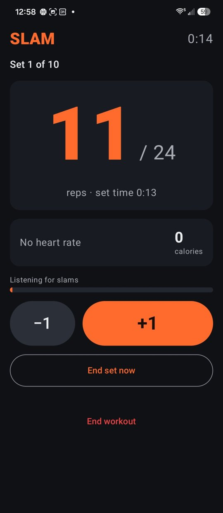
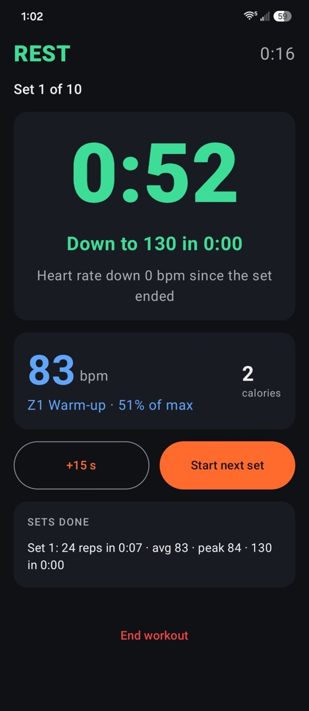
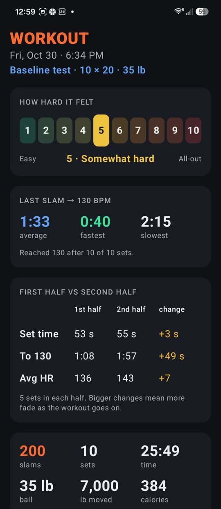
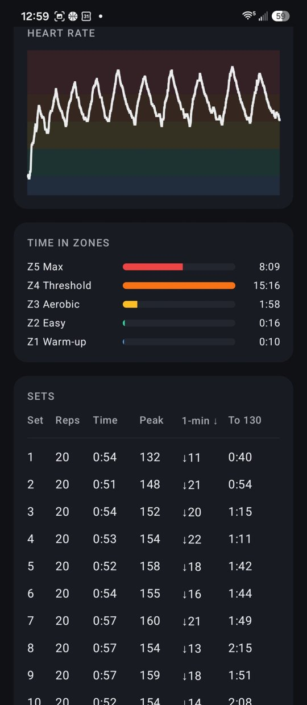

# Slam Log

An Android app for slam ball workouts, built around a Bluetooth chest strap (COOSPO H808S, or any strap
that uses the standard Bluetooth Heart Rate service). It counts slams by listening through the microphone,
coaches with voice and beeps, and tracks how fast your heart rate recovers after each set.

<p>
  
  
  
  
</p>

## Try it

Download the latest APK from [Releases](https://github.com/michaellaurio-oss/slamball-app/releases/latest)
on an Android phone (8.0 or newer) and open it to install. Android will ask you to allow installs from
your browser, and Play Protect may warn that the app is unknown; tap **Install anyway**. Any Bluetooth
chest strap that uses the standard heart rate service works.

Releases are built by GitHub Actions ([release.yml](.github/workflows/release.yml)) from the code in this repo.

## The headline metric: last slam → 130

After every set, Slam Log starts a clock at your **last slam** and stops it when your heart rate falls to
your recovery target (130 bpm by default; change it in the Training workout section on Home). You see it:

- live on the rest screen, counting up, with a voice callout when you hit it ("130 in 48 seconds")
- per set on the workout summary, plus average, fastest and slowest
- on every History card, and charted across workouts on **Trends**

The final set is measured too: the recovery check after it runs at least a minute, and on until you
reach the target (up to 5 minutes).

**Rest until HR ≤ 130** (Home screen switch): instead of a fixed rest,
rest lasts a **minimum rest** (60 s by default; set it on the Home screen) or until you're down to
130, whichever is longer. If you're not at 130 when the minimum runs out, the clock holds and counts
up until you are, then gives you 5 seconds to go. Every set gets a time-to-130.

## Baseline test: is my recovery improving?

Training workouts get bigger over time (more reps per set), and bigger sets take longer to recover from,
so they can't answer "is my recovery improving?" on their own. The **baseline test** can.

- It's the same workout every time: **10 sets × 20 reps**, same ball, resting at least 60 s and until
  HR ≤ 130. The baseline has its own minimum rest and its own recovery target (both in Baseline
  settings), so changing the training ones on the Home screen doesn't affect it.
  Home → **BASELINE** opens its own screen with your progress and the Start button. Its definition
  lives under **Baseline settings** at the bottom of that screen; only tests that match the current
  definition are compared.
- Repeat it every couple of weeks. Trends → **Is my recovery improving?** compares the latest baseline
  with the first one (average time from last slam to 130, plus the first-minute heart rate drop) and
  answers in a sentence. Changes under 3 seconds or 5% count as "about the same".
- **By reps per set** (Trends) compares training workouts only with others at the same reps per set.
- A workout can be marked or unmarked as a baseline from its summary screen. Baselines only count
  when every set was finished.
- Any workout can be **locked** from its summary screen; a locked workout has no delete button until
  you unlock it. Finished baseline tests are locked automatically. History marks them LOCKED.

## Everything else

- **Rep-based sets**: choose sets, reps per set, rest and ball weight. The set ends itself at the target.
- **Automatic rep counting** from the microphone, with +1 / −1 buttons to fix misses.
- **Slam effects**: a flash, shockwave rings and flying debris behind the rep count on every slam,
  with a screen shake; a bigger green burst when a set is finished. Can be turned off.
- **Heart rate zones** from your max heart rate, time in each zone, and a heart rate chart per workout.
- **Max heart rate warning** (optional, in About you): pick a limit and a klaxon sounds if your heart
  rate reaches it during a workout, repeating every 15 seconds while it stays there.
  Age comes from your **birthday**, so max HR (220 − age) and the zones update each year;
  a known real max HR can be entered instead.
- **1-minute recovery**: how far heart rate dropped in the first minute after each set.
- **Time per set** (Trends): how long each finished set takes, start beep to last rep, compared only at
  the same reps per set, with seconds per rep charted over time. Baseline tests show it too.
- **First half vs second half**: on each workout summary, and in Trends for the latest workout and latest
  baseline: set time, time to 130 and average HR for the first half of the sets against the second half,
  plus a chart of how much the second half slows down over time.
- **Effort rating**: after each workout, rate it 1–10 (easy → all-out). Shown in History and charted
  on Trends.
- **Calories**, estimated from heart rate, age, weight and sex (Keytel formula).
- **Voice and beeps**: set start, rest countdown and recovery results are spoken. During a set there's no
  talking (so the mic hears every slam), just a boxing-ring bell (ding-ding-ding) when 3 reps are left.
- **History and Export**: every workout is saved on the phone; Export shares every set as a CSV
  spreadsheet (email it to yourself, open it in Excel, or give it to Claude to analyze).

No accounts, no internet, no ads. Data stays on the phone.

## Build and install (Windows)

Uses a portable toolchain, no Android Studio needed:
Java 17 in `D:\Users\<you>\Android\jdk-17` and the Android SDK in `D:\Users\<you>\Android\sdk`.
Create `local.properties` (not committed) containing:

```
sdk.dir=D\:\\Users\\<you>\\Android\\sdk
```

Then:

1. On the phone: Developer options → **USB debugging** on. Plug it in and tap **Allow** on the prompt.
2. Double-click **install.bat**. It builds the app and installs it with adb.
   The first build takes a few minutes; later ones are quick and keep your data.

Manual equivalent (PowerShell, in the project folder):

```
$env:JAVA_HOME='D:\Users\<you>\Android\jdk-17'; .\gradlew.bat assembleDebug
D:\Users\<you>\Android\sdk\platform-tools\adb.exe install -r app\build\outputs\apk\debug\app-debug.apk
```

No cable? Copy `app\build\outputs\apk\debug\app-debug.apk` to the phone and open it there.
If adb lists the phone as `unauthorized`, unlock the phone and tap **Allow** on "Allow USB debugging?".

Requires Android 8.0 or newer.

**Lost or replaced the PC?** See [RECOVERY.md](RECOVERY.md) for rebuilding from GitHub.

**Why the signing key is committed.** `app/debug.keystore` is in the repo on purpose. Slam Log is a
sideloaded personal app, not a Play Store release, and Android only installs an update over an
existing app if both are signed with the same key. Keeping the key with the code means any PC, and
the GitHub release build, can update the installed app without uninstalling it, which would delete
the workout history stored on the phone. It's a debug key with no other use; an app published to
the Play Store would use a private upload key instead.

## First workout checklist

1. On first launch, allow **Nearby devices** (strap) and **Microphone** (slam counting).
2. Wet the strap's electrode pads and put it on; the H808S wakes up on skin contact.
3. Home → **Find strap** → **Connect**. Afterwards it reconnects on its own.
4. Settings → **About you**: set **birthday** and **body weight**; set **max heart rate** if you know it.
5. Settings → **Test slam detection**: do 10 slams and check the count. Too many → lower sensitivity;
   missing slams → raise it.
6. Put the phone a few feet from where the ball lands, screen up, and press **Start**.

## Tuning notes

- A slam counts when a sound is several times louder than the room's background noise and above a
  minimum loudness. After a count, sound is ignored for 0.7 s so one slam isn't counted twice, which
  caps auto-counting at about 85 slams a minute.
- While the phone is beeping or talking, it needs a much louder hit to count, so it doesn't count its
  own voice.
- If the strap stops sending heart rate during a rest for 15 s, the app stops waiting for the target
  ("Lost heart rate") and moves on, instead of holding the rest.
- Loud music or other people slamming nearby can add extra reps: use −1, or lower sensitivity.
- The screen stays on during a workout. If you switch apps or the screen goes off, the workout keeps
  running: a "workout in progress" notification shows the current set or rest, and tapping it brings
  you back. (Allow notifications when asked, so you can see it.) Swiping Slam Log away from recent
  apps still ends the workout.

## Project layout

```
app/src/main/java/com/laurio/slamlog/
  MainActivity.kt               screens, navigation, permissions
  ble/HeartRateManager.kt       Bluetooth heart rate (standard service 0x180D, characteristic 0x2A37)
  audio/SlamDetector.kt         microphone slam detection
  audio/Speaker.kt              voice callouts (text-to-speech) and beeps
  workout/WorkoutViewModel.kt   workout engine: sets, rest, recovery timing, saving
  workout/Physiology.kt         heart rate zones and calories
  workout/Progress.kt           baseline comparison, by-reps grouping, CSV export
  data/                         settings (SharedPreferences) and history (JSON in app storage)
  ui/                           Home, Workout, Summary, History, Trends, Baseline, Baseline settings, Settings, About you, effects, effort scale
install.bat                     build + install on a USB-connected phone
```

Kotlin 2.0, Jetpack Compose (Material 3), Android Gradle Plugin 8.7, Gradle 8.11.1, minSdk 26, targetSdk 35.

## Credits

- Heart rate alarm sound (`app/src/main/res/raw/klaxon.wav`): ["Ahooga Horn"](https://www.freesoundslibrary.com/ahooga-horn/)
  from Free Sounds Library (freesoundslibrary.com), licensed [CC BY 4.0](https://creativecommons.org/licenses/by/4.0/).
  Changes: trimmed to 1.95 s, converted to mono WAV, short fade-out added.
